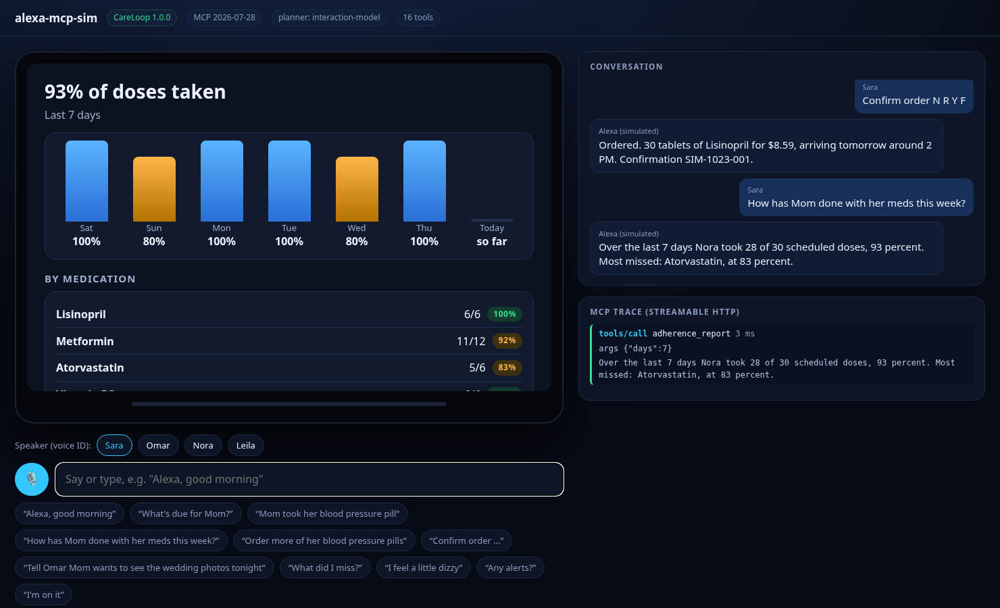

# CareLoop: Alexa+, for families caring for someone at home

**A self-hosted MCP server (Streamable HTTP, MCP 2025-11-25 and 2026-07-28) that turns Alexa+ into the care coordinator a family shares:** who gave Mom her pills, what's due, when the refill arrives, who's driving to the cardiologist, and what happened while you were at work.

> "Alexa, good morning."
> "Good morning, Sara. Due for Nora: Lisinopril, Metformin and Vitamin D3 at 8 AM. Tomorrow: Cardiology check-up with Dr. Patel at 10:30 AM, Omar driving. Lisinopril is running low. Latest note from Omar: Mom slept well."

63 million Americans, nearly 1 in 4 adults, are family caregivers ([AARP & NAC, *Caregiving in the US 2025*](https://www.aarp.org/press/releases/2025-07-24-new-report-reveals-crisis-point-for-americas-63-million-family-caregivers.html)). Many of them are juggling a job and a group chat to keep track of one parent's medications. Every family reinvents the same fragile system: a pill box, a whiteboard, a WhatsApp thread, and the question "did anyone give her the 8 o'clock one?". CareLoop puts that system where the family already talks to the house: the Echo in the kitchen.

<p> <br> </p>

*Screens: the Echo Show cards (MCP Apps), shown in [alexa-mcp-sim](https://github.com/dohmnsama1-sketch/alexa-mcp-sim).*

## What it does

| | |
|---|---|
| **One-call briefing** | `care_briefing` orchestrates doses, missed doses, refills, agenda, alerts and new handoff notes into one 3-sentence answer plus an Echo Show card. |
| **Shared dose log with a double-dose guard** | "Mom took her blood pressure pill" logs the dose against the right slot. If Omar tries to log it again 10 minutes later, CareLoop refuses, says who already logged it and when, and only records an extra dose if a caregiver explicitly confirms. Then it alerts everyone. |
| **Safe voice purchasing** | Refills are two-step: `refill_quote` prices a 30-day supply and gives a 4-character code made from letters that are hard to mishear ("U Y F V"); `refill_confirm` places it only when the code is said back, by a member allowed to buy, before it expires, under the monthly spending cap. Confirming twice never double-orders. |
| **Memory across sessions, per person** | Handoff notes ("Tell Omar Mom skipped lunch") and "What did I miss?" track what each caregiver has already heard. |
| **Check-ins with red-flag escalation** | When Nora says "I feel dizzy" or "I fell", every caregiver is alerted at once and the reply points to emergency services. "I'm on it" lets the others know someone is handling it. |
| **Screens, not just voice** | 6 tools ship **MCP Apps** cards (`ui://careloop/*.html`, `text/html;profile=mcp-app`): briefing dashboard, swipeable dose carousel, 7-day adherence chart, quote and receipt, alerts. |
| **Agent Skill included** | [`skills/careloop/SKILL.md`](skills/careloop/SKILL.md) teaches any agent the voice rules and safety flows (open Agent Skills format). |

Every tool result has a `speech` field written for the ear (times as "8 AM", grouped medications, no lists read aloud) plus full `structuredContent` for screens and agents.

## Safety by design (enforced in code, not left to the model)

- **No medical advice.** CareLoop records what the family and prescriber scheduled; it never suggests doses.
- **Double-dose guard** per medication (`min_interval_hours`).
- **Purchases:** quote then code confirmation; role permission (`can_purchase`); 10-minute expiry; one live quote per medication; monthly cap; idempotent confirm; every write in an audit log.
- **Emergency wording** on red-flag check-ins; alerts go to all caregivers except the reporter.
- **Transport:** DNS-rebinding protection (Host and Origin checks), optional bearer token (`CARELOOP_TOKEN`, constant-time compare), atomic JSON writes.
- **All four MCP behaviour hints on every tool** (`readOnlyHint`, `destructiveHint`, `idempotentHint`, `openWorldHint`) so hosts can auto-approve reads and ask before purchases.

The pharmacy is a deterministic **simulator** behind a `Pharmacy` interface (`pharmacy.py`), and every order says `simulated: true`. A real refill API plugs in without touching the tools.

## Run it (2 minutes)

Python 3.10+.

```bash
python -m venv .venv && source .venv/bin/activate
pip install -e ".[test]"
careloop-seed --now 2026-10-23T08:05            # demo household: the Haddad family caring for Nora
CARELOOP_NOW=2026-10-23T08:05 careloop          # http://127.0.0.1:8765/mcp  (Streamable HTTP)
pytest -q                                       # 35 tests: core, MCP in-process (both protocol eras), real HTTP
```

**See and hear it like an Alexa+ customer.** Alexa+'s own add-on tools (MCP Toolkit, Web Simulator) are in closed preview, so this entry comes with [alexa-mcp-sim](../alexa-mcp-sim), an open-source Echo Show-style simulator that works with any MCP server:

```bash
pip install -e ../alexa-mcp-sim
alexa-mcp-sim --server http://127.0.0.1:8765/mcp --model demo/interaction-model.json --planner model
# open http://127.0.0.1:8787: pick a speaker, tap the mic (Chrome/Edge) or type
```

Connect any other MCP client to `http://127.0.0.1:8765/mcp`, or run `careloop --stdio` for desktop clients.

| Variable | Default | Meaning |
|---|---|---|
| `CARELOOP_DATA` | `data/careloop.json` | household state file |
| `CARELOOP_HOST`, `CARELOOP_PORT` | `127.0.0.1`, `8765` | bind address |
| `CARELOOP_TOKEN` | unset | require `Authorization: Bearer <token>` on `/mcp` |
| `CARELOOP_ALLOWED_HOSTS` | unset | extra Host headers when deployed behind a domain |
| `CARELOOP_NOW` | unset | freeze the clock (demos and tests) |

## Tools (16)

`care_briefing` · `meds_due` · `dose_log` · `med_add` · `adherence_report` · `refill_status` · `refill_quote` · `refill_confirm` · `note_add` · `whats_new` · `checkin` · `alerts_list` · `alert_ack` · `appointment_add` · `agenda` · `household_overview`.
Resources: `careloop://household`, `careloop://today`, 5 `ui://careloop/*` cards. Prompts: `morning_briefing`, `end_of_day_handoff`.

## Architecture

```
Alexa+ / any MCP host ──Streamable HTTP──▶ server.py   (MCP tools, MCP Apps cards, auth, transport security)
  (or alexa-mcp-sim)                          │
                                              ▼
                                           core.py     (domain logic and safety rules; every result has `speech`)
                                              │
                         store.py (atomic JSON) · clock.py (household time zone) · pharmacy.py (adapter)
```

Built on the official MCP Python SDK (`mcp` 2.3: `MCPServer`, `mcp.server.apps.Apps`, `streamable_http_app`).

## Limits, honestly

- Not a medical device, and it gives no medical advice. Alerts are household notifications, not emergency dispatch.
- Built and demoed against an open simulator, because hackathon participants can't access the gated Alexa+ add-on tools.
- Single-household JSON store: right for a self-hosted family server. A multi-tenant version would use DynamoDB.

MIT licensed.
