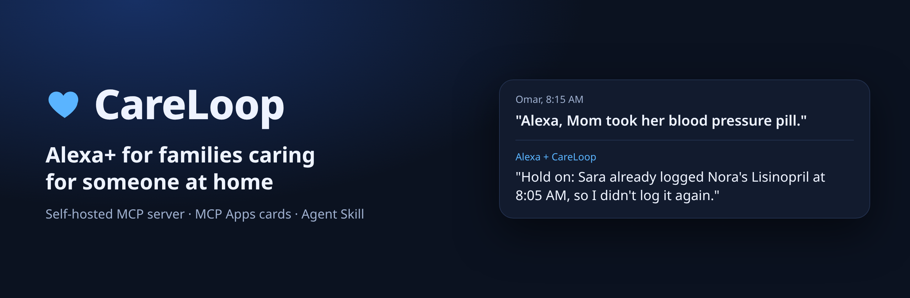
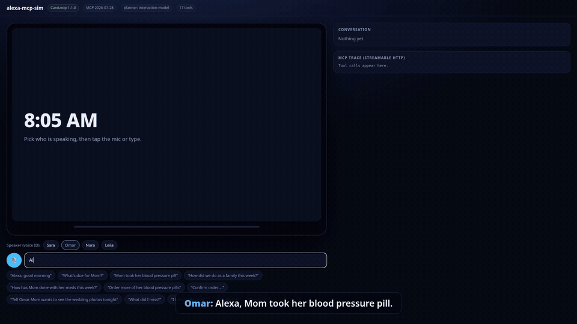
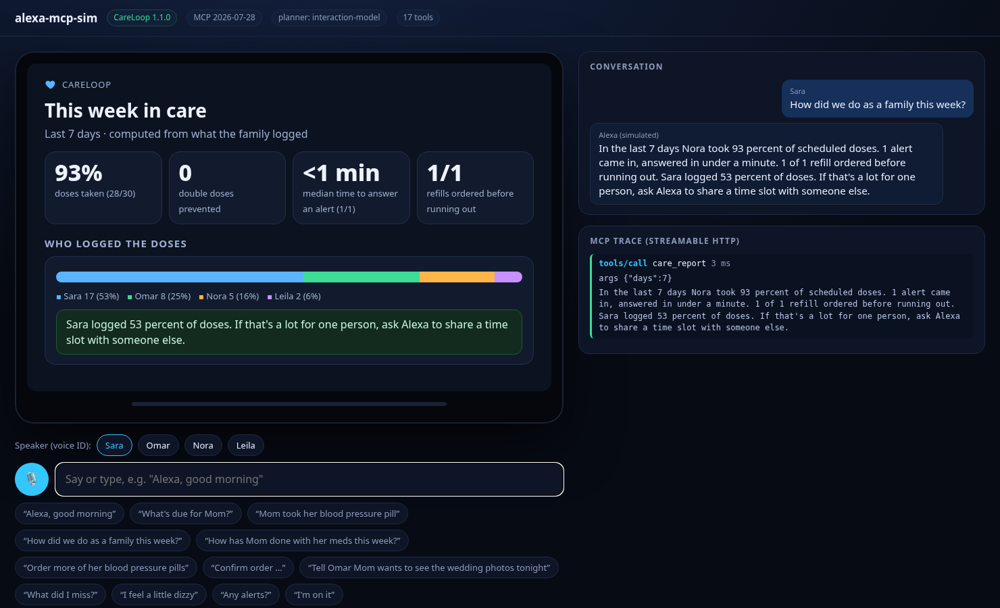
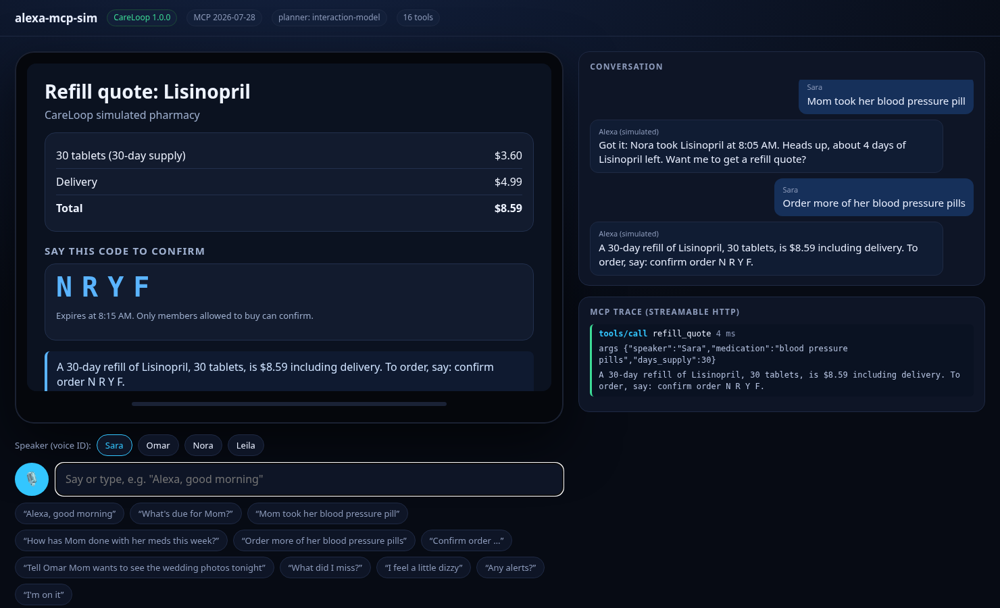
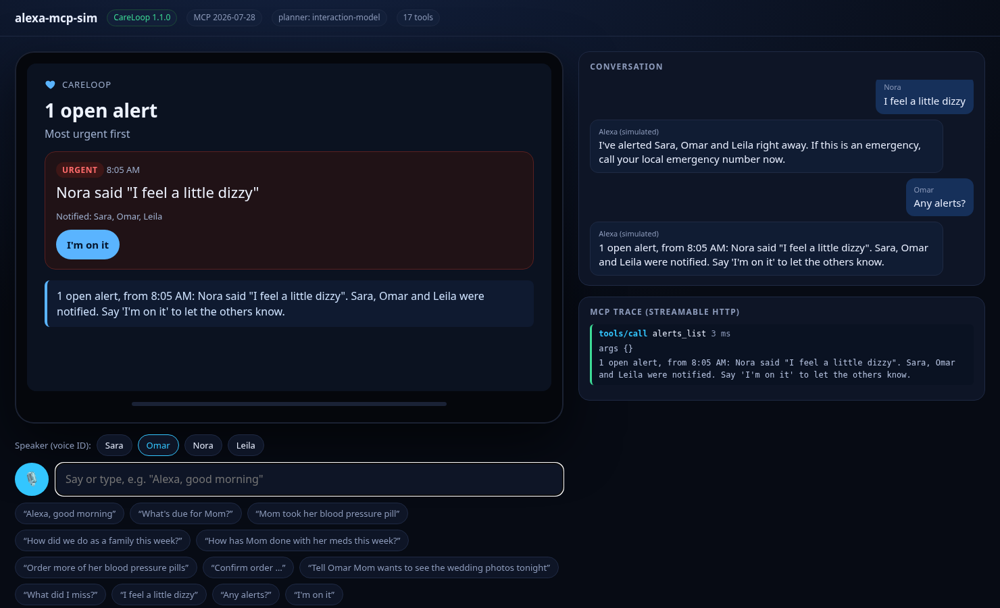
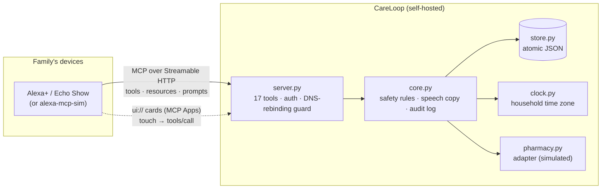

<p align="center"></p>

<p align="center">
<a href="https://github.com/dohmnsama1-sketch/careloop/actions/workflows/ci.yml"></a>


<a href="LICENSE"></a>
</p>

**CareLoop turns the Echo in the kitchen into the care coordinator a whole family shares.** It is a self-hosted MCP server for Alexa+. Siblings, a spouse and a part-time helper can all ask it who gave Mom her pills, what is due, when the refill arrives and what happened while they were at work. It stops double doses, orders refills safely by voice and alerts everyone when Mom says she feels dizzy.

<p align="center"></p>

## Why

- **63 million** Americans are family caregivers. They give an average of **27 hours of care a week**, and **55%** perform medical or nursing tasks (such as injections or monitoring vital signs), yet only **22%** were trained for them ([AARP & NAC, *Caregiving in the US 2025*](https://www.aarp.org/content/dam/aarp/ppi/topics/ltss/family-caregiving/caregiving-in-us-2025.doi.10.26419-2fppi.00373.001.pdf)).
- About **half of medications are taken incorrectly** (timing, dose, frequency), and nonadherence costs the US **$100–300 billion** a year ([CDC, MMWR 2017](https://www.cdc.gov/mmwr/volumes/66/wr/mm6645a2.htm)).
- Amazon's own caregiver service, Alexa Together, which let up to 10 family members share care, **is no longer available** ([About Amazon](https://www.aboutamazon.com/news/devices/alexa-together-is-helping-bridge-the-miles-between-families)). Alexa+ now reaches services through MCP, so a family can host its own CareLoop.

## Quickstart (under 60 seconds)

Needs [uv](https://docs.astral.sh/uv/). Two terminals:

```bash
uvx --from git+https://github.com/dohmnsama1-sketch/careloop careloop --demo
uvx --from git+https://github.com/dohmnsama1-sketch/alexa-mcp-sim alexa-mcp-sim --model careloop
```

Open http://127.0.0.1:8787, pick who is speaking (Sara, Omar, Nora or Leila), then tap a sample or the mic. `--demo` creates the Haddad family caring for Nora, and its clock starts at 8:05 AM today.

<details><summary>Without uv, or to run the tests</summary>

```bash
git clone https://github.com/dohmnsama1-sketch/careloop && cd careloop
python -m venv .venv && source .venv/bin/activate
pip install -e ".[test]"
careloop --demo                 # MCP endpoint: http://127.0.0.1:8765/mcp (Streamable HTTP)
pytest -q                       # 42 tests
```
Point any MCP client at `http://127.0.0.1:8765/mcp`, or run `careloop --stdio` for desktop clients.
</details>

## What it does

| | |
|---|---|
| **"Alexa, good morning"** | `care_briefing` pulls doses, missed doses, refills, appointments, alerts and new family notes into one three-sentence answer and an Echo Show dashboard. |
| **Double-dose guard** | "Mom took her blood pressure pill" maps the everyday name to Lisinopril and to the 8 AM slot. If Omar logs it again ten minutes later, CareLoop refuses and says who logged it and when. A second dose is recorded only after an explicit confirmation, and then the family is alerted. |
| **Safe voice purchasing** | `refill_quote` prices a 30-day supply and gives a 4-character code made only of letters that are hard to mishear. `refill_confirm` orders only when someone says the code back, and only if that person may buy, the code is under 10 minutes old and the order fits the monthly cap. A repeated confirm returns the same order, so "Yes" alone never buys anything. |
| **Memory per person, across sessions** | Each caregiver has handoff notes ("Tell Omar Mom wants the wedding photos") and their own "What did I miss?". |
| **Check-ins with escalation** | "I feel dizzy" or "I fell" alerts every caregiver at once and gives emergency wording. "I'm on it" lets the others know someone is handling it. |
| **A measurable week** | `care_report` reports adherence, double doses prevented, median minutes to answer an alert, refills ordered before running out and **who carries the load**. When one person logs most of the doses, it suggests sharing them. Every number comes from logged events. |
| **Screens and touch** | 7 tools render **MCP Apps** cards (`ui://careloop/*.html`): a dashboard, a dose carousel, an adherence chart, a quote and receipt, alerts and the weekly report. Cards have touch actions ("Mark given", "I'm on it") through MCP Apps `tools/call`. **Purchases stay voice-only by design.** |
| **Agent Skill** | [`skills/careloop/SKILL.md`](skills/careloop/SKILL.md) teaches any agent the voice style and the safety flows. |

Every result has a short `speech` string written for the ear, with times like "8 AM", medications grouped by time and no lists read aloud. Every result also carries full `structuredContent` for screens and agents.

<p> <br> </p>

## Architecture



Built on the official MCP Python SDK (`mcp` 2.3: `MCPServer`, `streamable_http_app`, MCP Apps via `mcp.server.apps.Apps`). The server speaks both the 2025-11-25 handshake and the 2026-07-28 protocol, and the tests cover both.

## Safety, privacy and trust

These rules are **enforced in code and covered by tests**. They do not depend on the model following a prompt.

- **No medical advice.** CareLoop records what the prescriber scheduled. It never suggests a dose.
- **Double-dose guard** per medication (`min_interval_hours`). Each blocked attempt is audited.
- **Purchases** need a quote plus the spoken code, permission to buy, a 10-minute expiry, a single live quote per medication and a monthly cap. A repeated confirm returns the same order, and every write goes to the audit log.
- **Escalation:** red-flag check-ins notify all caregivers and give emergency-services wording.
- **Privacy:** self-hosted, and the household's data stays in one JSON file the family controls. There is no analytics or third-party call, and the pharmacy is a local simulator that marks every order `simulated: true`. See [SECURITY.md](SECURITY.md).
- **Transport:** Host and Origin checks against DNS rebinding, an optional bearer token compared in constant time (`CARELOOP_TOKEN`) and atomic writes.
- **Honest hints:** every tool declares all four MCP behaviour hints, so a host can approve reads automatically and ask before purchases.

## Accessibility

- Voice comes first: answers are short, slow-paced and listen-friendly. Purchase codes leave out characters that are easy to confuse (0/O, 1/I/L, 2/Z, 5/S, 6/G, 8/B).
- Cards use `aria-live` updates, labelled buttons and touch targets of at least 44 px. Status is shown as text, not only colour.
- `prefers-reduced-motion` and `prefers-contrast: more` are respected.
- Nora, the person being cared for, uses CareLoop too: she can check in and log her own doses.

## Tools (17)

`care_briefing` · `meds_due` · `dose_log` · `med_add` · `adherence_report` · `care_report` · `refill_status` · `refill_quote` · `refill_confirm` · `note_add` · `whats_new` · `checkin` · `alerts_list` · `alert_ack` · `appointment_add` · `agenda` · `household_overview`

Resources: `careloop://household`, `careloop://today` and 6 `ui://careloop/*` cards. Prompts: `morning_briefing`, `end_of_day_handoff`.

| Variable | Default | Meaning |
|---|---|---|
| `CARELOOP_DATA` | `data/careloop.json` | household state file |
| `CARELOOP_HOST`, `CARELOOP_PORT` | `127.0.0.1`, `8765` | bind address |
| `CARELOOP_TOKEN` | unset | require `Authorization: Bearer <token>` on `/mcp` |
| `CARELOOP_ALLOWED_HOSTS` | unset | extra Host headers when deployed behind a domain |
| `CARELOOP_NOW` | unset | freeze the clock (tests) |
| `CARELOOP_DEMO_SEED` | unset | repeatable quote codes for recorded demos only |

## Limits, honestly

- CareLoop is not a medical device. Alerts are household notifications, not emergency dispatch.
- It was built and demoed against [alexa-mcp-sim](https://github.com/dohmnsama1-sketch/alexa-mcp-sim), because hackathon participants cannot use the gated Alexa+ add-on tools.
- The store holds one household in a JSON file, which suits a self-hosted family server. A hosted multi-family version would use DynamoDB.
- The demo household and its history are synthetic.

Built for the [Amazon Developer Hackathon 2026](https://amazonappdev2026.devpost.com/) (Alexa+ track). See [CHANGELOG.md](CHANGELOG.md) and [FRICTION_LOG.md](FRICTION_LOG.md). MIT licensed.
